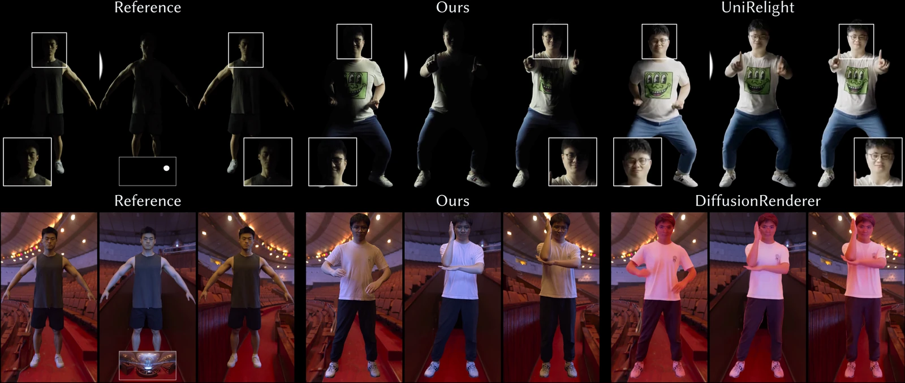
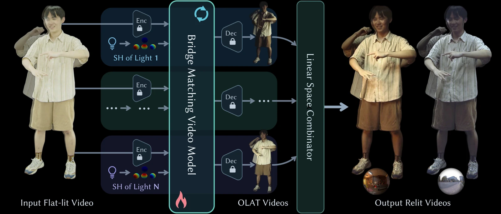

<div align="center">

<h1>DynOLAT</h1>
<h3>OLAT Video Prediction for Controllable Dynamic Full-Body Relighting</h3>

<p>
<a href="https://xiaotao1340.github.io/"><strong>Taoming Liu</strong><sup>1,*</sup></a> ·
<a href="https://stland-admin.github.io/"><strong>Yinji ShenTu</strong><sup>1,*</sup></a> ·
<a href="https://www.guangzhaohe.com/"><strong>Guangzhao He</strong><sup>2</sup></a> ·
<a href="https://krahets.com/"><strong>Yudong Jin</strong><sup>1</sup></a> ·
<strong>Yukang Ye</strong><sup>3</sup><br>
<a href="https://derizsy.github.io/"><strong>Siyu Zhang</strong><sup>3</sup></a> ·
<strong>Fan Jia</strong><sup>4</sup> ·
<a href="http://www.cad.zju.edu.cn/home/huawei/"><strong>Wei Hua</strong><sup>1,5</sup></a> ·
<a href="http://www.cad.zju.edu.cn/home/bao/"><strong>Hujun Bao</strong><sup>1</sup></a> ·
<a href="https://www.xzhou.me/"><strong>Xiaowei Zhou</strong><sup>1,†</sup></a>
</p>

<p>
<sup>1</sup> Zhejiang University · <sup>2</sup> Cornell University · <sup>3</sup> 4DV.ai<br>
<sup>4</sup> Ant Group · <sup>5</sup> Zhejiang Lab<br>
<sup>*</sup> Equal contribution. <sup>†</sup> Corresponding author.
</p>

<p><strong>SIGGRAPH Asia 2026 · ACM Transactions on Graphics (TOG)</strong></p>

<p>
<a href="https://arxiv.org/abs/2611.11210"></a>
<a href="https://zju3dv.github.io/DynOLAT/"></a>
<a href="https://huggingface.co/datasets/STLAND/ZJU_OLAT"></a>
<a href="https://zju3dv.github.io/DynOLAT/#demo"></a>
</p>

</div>

**One video. Explicit light directions. Controllable relighting.**

DynOLAT predicts a moving person's appearance under individual light directions, then combines these predictions to control lighting direction and relative intensity.

[](assets/teaser.webp)

*DynOLAT more faithfully reproduces human appearance responses to variations in lighting direction and relative intensity.*

## News

- **2026:** DynOLAT is accepted to **SIGGRAPH Asia 2026 (TOG)**. The [paper](https://arxiv.org/abs/2611.11210) and [project page](https://zju3dv.github.io/DynOLAT/) are available.

## Method

Given a monocular flat-lit video, DynOLAT predicts temporally consistent **One-Light-At-a-Time (OLAT) basis videos**, each showing the same performance illuminated from a single direction. It combines these bases using weights derived from a target environment map.

[](assets/pipeline.webp)

Why OLAT, and why dynamic capture? Read [The Insights Behind DynOLAT](https://zju3dv.github.io/DynOLAT/project-source.html).

## Dataset

We introduce a dynamic capture pipeline and a large-scale full-body OLAT dataset with aligned flat-lit / OLAT supervision:

- **24M+ captured frames** with **4K multi-view capture**.
- **224 identity-outfit combinations:** Different outfits of the same person count separately.
- **Time-multiplexed capture and optical-flow alignment** to form paired supervision through motion.

The dataset is hosted on [ZJU_OLAT](https://huggingface.co/datasets/STLAND/ZJU_OLAT). Please follow the dataset page's license and access requirements to request access.

## Code

We are preparing the code and documentation for public release. Release updates will be posted here.

## Citation

If you find DynOLAT useful in your research, please cite:

```bibtex
@article{liu2026dynolat,
  author = {Liu, Taoming and ShenTu, Yinji and He, Guangzhao and Jin, Yudong and Ye, Yukang and Zhang, Siyu and Jia, Fan and Hua, Wei and Bao, Hujun and Zhou, Xiaowei},
  title = {{DynOLAT}: {OLAT} Video Prediction for Controllable Dynamic Full-Body Relighting},
  journal = {ACM Transactions on Graphics},
  volume = {45},
  number = {6},
  articleno = {209},
  month = {December},
  year = {2026},
  doi = {10.1145/3842500}
}
```

## License

This project is licensed under the [Project Registration License (PRL) v1.0](LICENSE).
